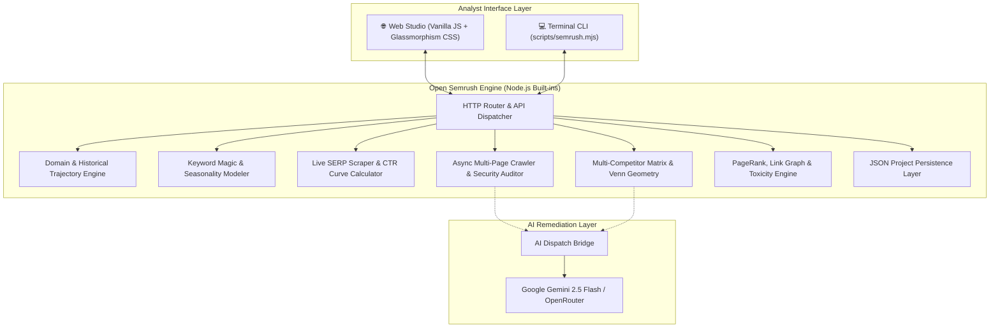

<div align="center">

# 🚀 Open Semrush (Semrush Studio)

### *The High-Performance, Privacy-First, Open-Source Alternative to Semrush & Ahrefs*

[](https://github.com/mightyalok00/open-semrush/releases)
[](https://opensource.org/licenses/MIT)
[](https://nodejs.org/)
[](https://www.docker.com/)
[](https://www.typescriptlang.org/)
[](#-zero-dependency-architecture)
[](https://github.com/mightyalok00/open-semrush/pulls)

<p align="center">
  <b>A self-hosted technical SEO audit and research prototype with crawling, modeled keyword metrics, SERP previews, competitor-gap exploration, backlink-profile demonstrations, and optional AI assistance.</b>
</p>

<p align="center">
  <a href="#-quickstart"><b>Quickstart (60s)</b></a> •
  <a href="#-interactive-dashboard-preview"><b>UI Tour</b></a> •
  <a href="#-feature-matrix--cost-comparison"><b>Why Open Semrush</b></a> •
  <a href="#-core-suite-capabilities"><b>Capabilities</b></a> •
  <a href="#-system-architecture"><b>Architecture</b></a> •
  <a href="#-docker-deployment"><b>Docker</b></a> •
  <a href="#-rest-api-documentation"><b>REST API</b></a> •
  <a href="#-cli-suite"><b>CLI Tools</b></a>
</p>

---

</div>

> [!TIP]
> **Zero Subscriptions. Zero Telemetry. 100% Unmetered.**  
> Self-host your own SEO intelligence platform on your laptop, VPS, or private cloud. Inspect unlimited domains and keywords with zero rate limits or paywalls.

---

## 🖥️ Illustrative Dashboard Preview

> All values in the ASCII mock dashboard below are illustrative examples, not verified measurements.

```text
 ┌────────────────────────────────────────────────────────────────────────────────────────┐
 │ 🌐 Open Semrush Studio           [ Domain: github.com ]  [ Country: 🇺🇸 US ▾ ]  [ Search ] │
 ├────────────────────────────────────────────────────────────────────────────────────────┤
 │                                                                                        │
 │  AUTHORITY SCORE       ORGANIC TRAFFIC        RANKED KEYWORDS       PENGUIN TOXICITY   │
 │  ┌───────────────┐     ┌───────────────┐      ┌───────────────┐     ┌───────────────┐  │
 │  │      86       │     │  48,250,000   │      │   2,840,110   │     │  12% (Low)    │  │
 │  │ █████████░░░░ │     │  ▲ +14.2% MoM │      │  ▲ +18,400 MoM│     │ 🟢 Safe Risk  │  │
 │  └───────────────┘     └───────────────┘      └───────────────┘     └───────────────┘  │
 │                                                                                        │
 │  📈 24-MONTH TRAFFIC TRAJECTORY & GOOGLE CORE UPDATE OVERLAYS                          │
 │  50M ┤                                           ★ Mar 26 Core   ★ Sep 26 Core         │
 │      │                                                /\               /\              │
 │  35M ┤                  ★ Aug 25 Core                /  \             /  \──           │
 │      │       /\              /\                     /    \───        /                 │
 │  20M ┤──────/  \────────────/  \───────────────────/         \──────/                  │
 │      └───────────────────────────────────────────────────────────────────────────────  │
 │        Oct 24   Jan 25   Apr 25   Jul 25   Oct 25   Jan 26   Apr 26   Jul 26   Oct 26    │
 │                                                                                        │
 │  ⚔️ MULTI-COMPETITOR GAP MATRIX                  ⭕ INTERACTIVE VENN DIAGRAM           │
 │  ┌────────────────────────────────────────┐       ┌─────────┐   Overlap   ┌─────────┐  │
 │  │ Keyword         github.com  gitlab.com │       │   YOU   │    (420)    │  RIVAL  │  │
 │  ├────────────────────────────────────────┤       │ (1,840) │   (Shared)  │ (1,120) │  │
 │  │ git hosting         #1 🥇       #3     │       │ Unique  │◄───────────►│ Missing │  │
 │  │ open source ci      #4          #1 🥇  │       └─────────┘             └─────────┘  │
 │  │ pull request flow   #1 🥇       —      │         [Click any bubble to jump to list] │
 └────────────────────────────────────────────────────────────────────────────────────────┘
```

---

## 📊 Feature Matrix & Cost Comparison

> Cost and quota comparisons are marketing estimates and have not been independently verified. Modeled metrics are not equivalent to paid-provider datasets.

Why pay **$1,500 – $6,000 every year** to SaaS vendors when you can own your SEO pipeline?

| Feature / Capability | 🚀 **Open Semrush** | 🟧 **Semrush (Pro/Guru)** | 🟦 **Ahrefs (Lite/Std)** |
| :--- | :---: | :---: | :---: |
| **Annual License Fee** | **$0 (Free & Open Source)** | $1,679 – $2,999 / yr | $1,548 – $2,988 / yr |
| **Monthly Query Quota** | **Unlimited (Unmetered)** | 500 – 1,500 queries / day | 500 export credits / mo |
| **Data Privacy & Telemetry** | **100% Local / Self-Hosted** | Third-party tracking | Third-party tracking |
| **Technical Site Health Audit** | **Included (TTFB, Security, Schema)** | Included | Included |
| **24-Month Google Algorithm Pins** | **Included (Interactive SVG)** | Guru tier required | Not correlated |
| **SERP preview (AI-generated or algorithmic fallback) + CTR** | **Included (Curve-based CTR)** | Included | Included |
| **Multi-Competitor Matrix (up to 5)** | **Included (Podium Badges)** | Guru tier ($249/mo) | Standard ($199/mo) |
| **Interactive SVG Venn Diagram** | **Included (Clickable Nav)** | Static table only | Static table only |
| **Penguin Toxicity Risk Score** | **Included** | Guru tier ($249/mo) | Separate add-on |
| **AI Remediation ("✨ Fix with AI")** | **Gemini & OpenRouter Built-in** | AI App Store ($20+/mo) | None / Manual |
| **AI Outrank Content Strategist** | **H1-H3 Outline + Points** | Marketplace ($/token) | None |
| **Data Export** | **RFC 4180 CSV + Print PDF** | Paywalled per seat | Paywalled export credits |
| **Cold Startup Time** | **< 100 ms (Pure Node)** | Cloud SaaS | Cloud SaaS |
| **RAM Footprint** | **< 35 MB Idle** | N/A | N/A |

---

## ⚡ Core Suite Capabilities

### 1. 🌐 Domain Overview & Historical Trajectory
- **Illustrative Authority Score (AS):** A heuristic score (1–100) factoring referring domain diversity, dofollow authority, and organic reach.
- **Multi-Country Traffic Breakdown:** Computes estimated monthly visits and ranked keyword indices across regional markets (`US`, `UK`, `IN`, `DE`, `CA`, `AU`).
- **24-Month Trajectory Area Chart:** Handcrafted vector SVG graph tracking 2-year traffic shifts with **milestone pins for real Google Core Algorithm Updates** (March 2025, August 2025, March 2026, September 2026).
- **Competitor Discovery:** Automatically detects top organic search rivals with one-click drill-down shortcuts.

### 2. 🔑 Keyword Magic Tool & Seasonality Trends
- **Modeled Search Volume & Keyword Difficulty (KD%):** Deterministic illustrative values; not provider-backed keyword research.
- **Commercial Intent Modeling:** Classifies user intent into `Commercial`, `Informational`, `Navigational`, or `Transactional`.
- **12-Month Seasonality Bars:** Visualizes seasonal demand peaks from January to December.
- **CPC & Competitive Density:** Evaluates paid advertising benchmarks ($ USD) and bidding competition (0.00 to 1.00).

### 3. 🎯 Live Google SERP Top 10 & SERP Features Inspector
- **SERP Preview:** Parses supplied SERP HTML or shows AI-generated/demo results. Current fallback results are not live-verified Google rankings.
- **Logarithmic CTR Curve:** Projects organic click distribution from Position 1 (39.8%) down to Position 10 (1.6%).
- **SERP Features Detection:** Identifies **Featured Snippets (Position 0)**, **People Also Ask (PAA)** interactive accordions, **Video Packs**, and **Knowledge Panels**.

### 4. 🛠️ Technical Site Audit, Security Headers & Crawler
- **Site Health Score (0–100):** Weighted audit scoring penalizing Errors (–5 pts), Warnings (–2 pts), and Notices (–0.5 pts).
- **On-Page Diagnostics:** Identifies title length infractions, missing meta descriptions, H1 tag irregularities, images missing alt attributes, and word count deficits.
- **Server Infrastructure & Security:** Validates `robots.txt`, XML sitemap discovery, Time to First Byte (TTFB) latency in ms, payload compression (gzip/br), `HSTS` (Strict-Transport-Security), `CSP` (Content-Security-Policy), and `Schema.org` JSON-LD Structured Data.
- **✨ Fix with AI:** Streams optimized, copy-paste HTML replacements directly into a modal drawer via Gemini.

### 5. ⚔️ Multi-Competitor Keyword Gap & SVG Venn Diagram
- **Multi-Domain Matrix (Up to 5 Domains):** Side-by-side keyword overlap table highlighting the ranking leader for each query with gold podium badges.
- **Tri-Category Segmentation:**
  - **Missing (Opportunity):** Keywords your competitors rank for, but your site does not.
  - **Shared:** Common battleground keywords where both domains compete.
  - **Unique:** Your proprietary competitive moat.
- **Interactive SVG Venn Diagram:** 2-circle vector illustration allowing you to click circle segments or intersection zones to smoothly scroll directly to target keyword lists.
- **⚡ Outrank Plan:** Produces an AI-crafted content blueprint with recommended title, word count, and H1/H2/H3 outline.

### 6. 🔗 Backlink Analytics & Penguin Toxicity Engine
- **Synthetic Backlink Profile:** Demonstration counts and generated example links; no live backlink index is queried.
- **Illustrative Link-Risk Heuristic:** A demonstration calculation evaluating suspicious TLDs, non-descriptive anchors, and linking velocity to assign `Low Risk`, `Moderate`, or `High Risk` warning levels.
- **Semrush Anchor Category Distribution:** Automatically classifies backlink anchor text into **Branded**, **Exact Match**, **Naked URL**, and **Generic** buckets.
- **Live Inbound Feed:** Real-time stream of incoming links with target destinations and source PageRank authority.

### 7. 📄 Data Portability & Executive Reporting
- **RFC 4180 CSV Export:** Exports all keyword tables and metrics with double-quote escaping for spreadsheet software (Excel, Google Sheets).
- **Executive PDF Print Stylesheet:** High-resolution unpaginated `@media print` styling for client deliverables and executive reports.

---

## 🏗️ System Architecture



---

## 🚀 Quickstart

### Option A: Local Run (Under 60 Seconds)

```bash
# 1. Clone repository
git clone https://github.com/mightyalok00/open-semrush.git
cd open-semrush

# 2. Configure environment variables (optional, needed for AI features)
cp .env.example .env

# 3. Start Open Semrush Studio
npm start
```

🎉 Open your browser at **`http://localhost:3000`**!

---

### Option B: Docker Compose

```bash
# Start in detached mode
docker compose up -d

# Check live logs
docker compose logs -f
```

To stop:
```bash
docker compose down
```

---

## 💻 CLI Suite

Open Semrush includes a terminal CLI utility for automation, pipelines, and developer workflows:

```bash
# Technical Site Audit (crawls 5 pages)
node scripts/semrush.mjs audit https://example.com --pages 5

# Keyword Difficulty & Intent Analysis
node scripts/semrush.mjs keyword "best seo tools"

# Domain Overview & Traffic Estimation
node scripts/semrush.mjs domain github.com

# Pairwise Competitor Keyword Gap
node scripts/semrush.mjs gap github.com gitlab.com

# Backlink Profile & Anchor Distribution
node scripts/semrush.mjs backlinks github.com
```

<details>
<summary><b>📺 Click to view sample terminal output</b></summary>

```text
$ node scripts/semrush.mjs keyword "seo tools"

⚡ Analyzing Keyword: "seo tools"...

=======================================================
🔑 KEYWORD OVERVIEW: "seo tools"
=======================================================
Search Volume:        165,000 / mo
Keyword Difficulty:   74% (Hard)
Search Intent:        Commercial
Cost Per Click (CPC): $8.40 USD
Competitive Density:  0.89 (0.00 - 1.00)
-------------------------------------------------------
Related Variations & Questions:
  • best free seo tools
  • seo tools for digital marketing
  • what are the best automated seo tools?
  • automated seo audit software
=======================================================
```
</details>

---

## 📡 REST API Documentation

> The API currently returns modeled/synthetic SEO metrics for several endpoints. A successful HTTP response does not imply that traffic, keyword, backlink, or ranking data was obtained from a live data provider.

Open Semrush exposes clean JSON endpoints for integration into third-party dashboards, automated CI/CD checks, and data pipelines:

| Method | Endpoint | Query / Body Parameters | Response Summary |
| :--- | :--- | :--- | :--- |
| `GET` | `/api/domain` | `?domain=github.com&country=us` | Authority Score, monthly traffic, top keywords, 24-month history |
| `GET` | `/api/keyword` | `?q=seo+tools` | Search volume, KD%, intent, CPC, 12-month seasonality |
| `GET` | `/api/serp` | `?q=best+seo+software` | Top 10 rankings, snippet, CTR, PAA questions, featured snippet |
| `POST` | `/api/audit` | `{"url": "https://example.com", "maxPages": 5}` | Health score, on-page issues, TTFB latency, security headers |
| `GET` | `/api/gap` | `?domainA=site1.com&domainB=site2.com` | Pairwise missing, shared, and unique keyword arrays |
| `GET` | `/api/gap/multi` | `?domains=site1.com,site2.com,site3.com` | Multi-competitor matrix with leader highlights |
| `GET` | `/api/backlinks` | `?domain=github.com` | Link count, referring domains, toxicity score, anchor distribution |
| `POST` | `/api/ai/fix` | `{"url": "...", "issueCode": "...", "message": "..."}` | Gemini copy-paste code snippet and SEO rationale |
| `POST` | `/api/ai/strategy` | `{"domainA": "...", "competitorDomain": "...", "missingKeyword": "..."}` | Outrank article blueprint, title, and H1/H2/H3 outline |
| `GET` | `/api/projects` | *None* | List of previously audited domains and health scores |

<details>
<summary><b>🔍 Click to view sample JSON API response (/api/domain)</b></summary>

```json
{
  "domain": "github.com",
  "authorityScore": 86,
  "estimatedMonthlyOrganicTraffic": 48250000,
  "totalRankedKeywords": 2840110,
  "topCompetitors": ["gitlab.com", "bitbucket.org", "sourceforge.net"],
  "history24Months": [
    { "month": "Jan 25", "organicTraffic": 42100000 },
    { "month": "Mar 25", "organicTraffic": 39800000, "googleUpdate": "March 2025 Core Update" },
    { "month": "Aug 25", "organicTraffic": 44500000, "googleUpdate": "August 2025 Core Update" },
    { "month": "Mar 26", "organicTraffic": 46800000, "googleUpdate": "March 2026 Core Update" }
  ]
}
```
</details>

---

## ⚙️ Environment Configuration

Create a `.env` file in the root directory:

```env
# Server Configuration
PORT=3000
NODE_ENV=production

# AI Remediation Engine (Gemini / OpenRouter)
# Free API key from Google AI Studio: https://aistudio.google.com/
GEMINI_API_KEY=your_gemini_api_key_here

# Optional: OpenRouter API key as alternative provider
OPENROUTER_API_KEY=your_openrouter_api_key_here
```

---

## 🔒 Zero-Dependency Guarantee

Unlike projects weighed down by hundreds of NPM dependencies, Open Semrush implements its core analysis engines using **pure Node.js runtime primitives**:
- `node:http` — Fast, native asynchronous HTTP server
- `node:fs` — Reliable filesystem persistence
- `node:url` — RFC 3986 URL parsing and normalization
- Native `fetch` — Streaming HTML crawler and outbound probes

> [!NOTE]
> **Why this matters for your infrastructure:**
> 1. **Small runtime dependency surface:** Core engine modules use Node.js built-ins; development still requires TypeScript tooling.
> 2. **Startup:** Measure locally for your deployment; no reproducible benchmark is published yet.
> 3. **Memory:** No reproducible memory benchmark is published yet.

---

## 🗺️ Roadmap & Upcoming Features

- [x] Technical Site Crawler with TTFB, HSTS, CSP, and Schema.org
- [x] Live Google SERP Top 10 with logarithmic CTR curve & PAA questions
- [x] 24-Month Traffic Trajectory Area Chart with Google Core Update pins
- [x] Multi-Competitor Gap Matrix (Up to 5 Domains) & Interactive SVG Venn Diagram
- [x] Backlink Analytics with Penguin Toxicity Scoring & Semrush Anchor Taxonomy
- [x] AI-Powered Code Remediation & Outrank Content Strategy Builder
- [x] RFC 4180 CSV Export & Executive Print PDF Stylesheet
- [ ] Core Web Vitals (LCP, FID, CLS) Real-User Metric Gauges
- [ ] Automated Scheduled Crawls with Webhook Alerts (Slack / Discord)
- [ ] Google Search Console (GSC) OAuth2 Integration

---

## 🤝 Contributing

Contributions make open-source software great. Here's how to contribute:

1. **Fork the Project** (`https://github.com/mightyalok00/open-semrush/fork`)
2. **Create your Feature Branch** (`git checkout -b feat/amazing-feature`)
3. **Commit your Changes** (`git commit -m 'feat: add amazing feature'`)
4. **Push to the Branch** (`git push origin feat/amazing-feature`)
5. **Open a Pull Request**

---

## 📜 License

Distributed under the **MIT License**. See [`LICENSE`](LICENSE) for details.

<div align="center">

### ⭐ Star us on GitHub — it helps the project grow!

Built with ❤️ by [mightyalok00](https://github.com/mightyalok00) and the open-source community.

</div>
