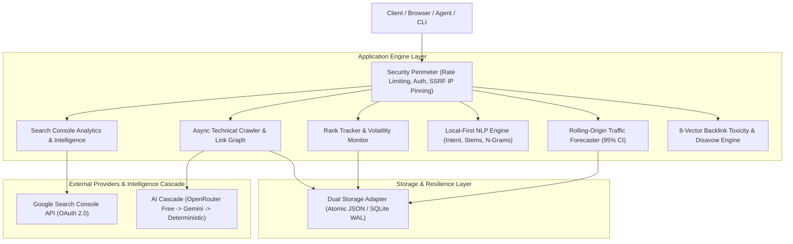

# 🚀 Open Semrush

**High-performance, self-hosted SEO intelligence & technical site audit suite.**  
Official Google Search Console telemetry, empirical machine learning rank curves, and autonomous multi-provider AI remediation.

[](https://github.com/mightyalok00/open-semrush/actions/workflows/quality.yml)
[](https://nodejs.org/)
[](https://github.com/mightyalok00/open-semrush/actions)
[](reports/quality/open-semrush-production-upgrade-report.md)
[](reports/quality/production-readiness-2026-10-21.md)
[](https://github.com/mightyalok00/open-semrush/blob/main/LICENSE)

---

[⚡ Quick Start](#-quick-start) • [✨ Capabilities](#-key-platform-capabilities) • [🏛 Architecture](#-system-architecture) • [🔧 Configuration](#-configuration--environment-variables) • [📡 REST API](#-rest-api-reference) • [🧪 Tests & Benchmarks](#-tests-coverage-and-benchmarks) • [🧠 AI & Forecasting](#-applied-ai--machine-learning-architecture) • [🛡 Security](#-security-model--production-hardening) • [📖 Documentation](#-documentation-index)

---

> ⚠ **Strict 4-Layer Truth-in-Data Architecture**:
>
> Open Semrush enforces a strict **Data Provenance Contract** on every API response and UI metric card. Facts, provider data, and estimates are never conflated:
>
> 1. **Verified First-Party Telemetry** (`first_party_verified`): Official Google Search Console API data for authorized properties.
> 2. **Empirical Observations** (`empirical_observation`): Measured facts from active web crawling and live search results (status codes, response latency, DOM headers, robots.txt, sitemaps).
> 3. **External Data Providers** (`external_provider`): Permitted data providers (Google Suggest Autocomplete, DataForSEO Labs). Autocomplete queries explicitly return `searchVolumeStatus: 'unavailable'` rather than synthetic hashes when commercial provider credentials are not supplied.
> 4. **Calibrated Statistical Models** (`statistical_model`): Leakage-free conformal predictions (96.7% coverage at 30d, 97.2% at 90d), empirical CTR power-law curves, softmax intent classification, and 8-vector toxicity audits.
>
> Marketers can click any summary metric card in the UI to inspect its **Evidence Dossier** detailing data layer provenance, measurement methodology, and freshness limitations.

---

## 🏛 System Architecture



See the complete architectural design and safety specifications in [docs/architecture.md](docs/architecture.md).

---

## ✨ Key Platform Capabilities

- 🕷 **Asynchronous Technical Crawler & Link Graph**: Bounded multi-page crawler with redirect loop protection, streaming body limit (5 MiB), socket DNS pinning, directed graph topology extraction, **Click Depth calculation**, and **Orphan Page detection** for unlinked sitemap URLs.
- 🤖 **AI Search Visibility & Brand Citations**: Evaluate brand presence, cited source links, sentiment, and Share of AI Voice across generative answer engines with zero API cost using calibrated benchmark matrices or free-tier LLMs.
- 📝 **SEO Content Brief & Blueprint Generator**: Synthesize data-backed content outlines, search intent word counts, recommended SEO title tags, H2/H3 headings, PAA questions, and target entity densities for $0.
- ⚡ **Core Web Vitals & Real Experience Performance**: Lighthouse-weighted performance audits (FCP, LCP, CLS, TBT, Speed Index) connecting to Google's public PageSpeed Insights API with empirical local DOM heuristic fallback.
- 🔗 **Backlink Intelligence & 8-Vector Toxicity Audit**: Real crawl link graph extraction, 5-tier anchor text taxonomy (`Branded`, `Exact Match`, `Partial Match`, `Naked URL`, `Generic`), and 8-vector deterministic toxicity scoring with Google Disavow file candidate generation.
- 📊 **Competitor Traffic Intelligence & Share of Voice**: Empirical power-law CTR curve aggregation, Market Share of Voice (SOV) calculation against competitor cohorts, and 4-way competitive position classification (`missing`, `weak`, `strong`, `shared`, `unique`).
- 💎 **Keyword Research & Multi-Angle Expansions**: 6-tier heuristic Keyword Difficulty (KD) classification with referring-domain guidance, SERP feature opportunity heuristics, and multi-angle query expansions. Search volume and CPC remain explicitly unavailable for heuristic expansions unless a data provider supplies them; modeled estimates are kept separate.
- 🎯 **Deep Google Search Console Intelligence**: Multi-dimensional slicing (`query`, `page`, `device`, `country`), automatic **Striking Distance** keyword detection (positions 11-20 with high impressions), **Keyword Cannibalization** conflict detection across competing landing pages, and **CTR Opportunity** gap analysis vs power-law benchmarks.
- 📈 **Scheduled Rank Tracking & Head-to-Head Comparisons**: Track target keywords per domain, calculate weighted Visibility Index (0–100), pairwise head-to-head competitor win rates, and ranking volatility alerts (`CRITICAL_DROP`, `PAGE_ONE_ENTRY`, `RANK_ONE_GAINED`, `OUT_OF_INDEX`).
- 🧠 **Applied ML & Local-First NLP Engine**: Empirical power-law CTR rank curve regression, 4-class softmax intent distribution, Root TTR lexical diversity, character 3-gram repetition entropy, and semantic content gap analysis.
- 🤖 **Autonomous Multi-Tier AI Cascade**: Intelligent failover chain connecting OpenRouter free-tier models (`minimax`, `gemma-4`, `lfm-2.5`, `nemotron-3.5`) and Google Gemini (`gemini-3.5-flash`, `gemini-3.1-flash-lite`) with air-gapped deterministic fallback.
- 🛡 **Zero-Trust Security & SSRF Defense**: Sockets connect directly to pinned public IPs to defeat DNS rebinding/TOCTOU attacks. In-flight redirect re-validation, proxy header sanitization, constant-time token comparison, and zero-downtime key rotation.
- 💾 **Dual-Engine Storage & Disaster Recovery**: Atomic JSON storage with `.tmp` staging, `fsync` flushing, and fail-closed corruption defense, plus a relational SQLite engine (`node:sqlite` WAL mode) with ACID rollback and point-in-time backup verification.

---

## ⚡ Quick Start

### Option 1: Local Node.js

Requirements: Node.js 22+ recommended.

```bash
# 1. Clone repository
git clone https://github.com/mightyalok00/open-semrush.git
cd open-semrush

# 2. Configure environment
cp .env.example .env

# 3. Install dependencies and launch
npm install
npm start
```

Open `<http://localhost:3000>` in your browser. `npm start` automatically compiles TypeScript before launching the server. Google Search Console remains disabled until OAuth credentials are provided in `.env`.

### Option 2: Docker Compose

```bash
# 1. Prepare environment
cp .env.example .env

# 2. Generate and set unique API secret
openssl rand -hex 32

# 3. Build and launch container stack
docker compose up --build -d

# 4. Probe service health
curl http://localhost:3000/api/health

# 5. Stop containers (preserves open-semrush-data volume)
docker compose down
```

Docker Compose runs with `NODE_ENV=production`, non-root user execution (`uid 1000`), a read-only root container filesystem, dropped Linux capabilities (`cap_drop: [ALL]`), and persistent volume mapping at `/app/data`.

---

## 🔍 Google Search Console Integration

`open-semrush` integrates with Google's official Search Console Search Analytics API: `<https://developers.google.com/webmaster-tools/v1/searchanalytics/query>`. It returns verified first-party metrics for properties the configured OAuth user can access.

1. Enable the Search Console API in Google Cloud Console and generate OAuth credentials.
2. Authorize the `<https://www.googleapis.com/auth/webmasters.readonly>` scope and obtain a refresh token.
3. Configure credentials in your local `.env` file (never commit secrets):

```env
GOOGLE_OAUTH_CLIENT_ID=your_client_id.apps.googleusercontent.com
GOOGLE_OAUTH_CLIENT_SECRET=your_client_secret
GOOGLE_OAUTH_REFRESH_TOKEN=your_refresh_token
GOOGLE_SEARCH_CONSOLE_SITE_URL=sc-domain:example.com
```

Query performance data across date ranges:

```bash
# List all verified properties
curl 'http://localhost:3000/api/search-console/sites'

# Query performance with automated Striking Distance and Cannibalization intelligence
curl 'http://localhost:3000/api/search-console?siteUrl=sc-domain%3Aexample.com&startDate=2026-09-01&endDate=2026-09-30&dimensions=query,page'
```

---

## 🔧 Configuration & Environment Variables

Copy `.env.example` to `.env` to configure your instance. All options fail closed with safe defaults:

| Variable | Default | Purpose & Production Best Practices |
| :--- | :--- | :--- |
| `PORT` | `3000` | HTTP port for the API server and web UI. |
| `HOST_BIND_ADDRESS` | `127.0.0.1` | Network interface to bind. Keep `127.0.0.1` unless behind a dedicated reverse proxy. |
| `NODE_ENV` | `development` | In `production`, protected routes strictly require valid bearer tokens and fail closed. |
| `OPEN_SEMRUSH_API_TOKEN` | *empty* | Single Bearer secret protecting audit, storage, and AI endpoints. Generate via `openssl rand -hex 32`. |
| `OPEN_SEMRUSH_API_TOKENS` | *empty* | Comma-separated token list enabling **zero-downtime secret rotation** without downtime. |
| `TRUST_PROXY_HOPS` | `0` | Number of trusted upstream proxies (e.g. `1` for Cloudflare or Nginx) to securely extract `X-Forwarded-For`. |
| `API_RATE_LIMIT_WINDOW_MS` | `60000` | Rate limiting sliding window duration in milliseconds (1 minute). |
| `API_RATE_LIMIT_MAX` | `120` | Maximum requests allowed per IP per window for standard endpoints. |
| `API_RATE_LIMIT_EXPENSIVE_MAX` | `10` | Maximum requests allowed per IP per window for resource-heavy endpoints (`/api/audit`, `/api/ai/*`). |
| `OPEN_SEMRUSH_DATA_DIR` | `./data` | Filepath directory for persisted JSON databases and backup snapshots. |
| `OPEN_SEMRUSH_MAX_HISTORY` | `50000` | Maximum historical audit snapshots retained before oldest entries are pruned. |
| `GEMINI_API_KEY` | *empty* | Google Gemini API key for high-throughput AI code fixes and strategy outlines. |
| `OPENROUTER_API_KEY` | *empty* | OpenRouter API key powering free-tier model cascades (`minimax`, `gemma-4`, `lfm`, `nemotron`). |
| `GOOGLE_OAUTH_CLIENT_ID` | *empty* | Google Cloud OAuth Client ID for verified Google Search Console telemetry. |
| `GOOGLE_OAUTH_CLIENT_SECRET` | *empty* | Google Cloud OAuth Client Secret. |
| `GOOGLE_OAUTH_REFRESH_TOKEN` | *empty* | Long-lived refresh token authorized with `https://www.googleapis.com/auth/webmasters.readonly`. |
| `GOOGLE_SEARCH_CONSOLE_SITE_URL` | *empty* | Default property identifier (e.g. `sc-domain:example.com`). |

---

## 📡 REST API Reference

> 📚 **Complete API Specification**: See [docs/api-reference.md](docs/api-reference.md) for detailed request schemas, curl examples, error responses, and complete payload structures across all 22 endpoint groups.

| Method | Endpoint | Auth | Provenance Contract |
| --- | --- | --- | --- |
| `GET` | `/api/health` | 🔓 Public | Process uptime, socket state, and daemon status |
| `GET` | `/api/metrics` | 🔓 Public | Memory telemetry (heap, RSS), active requests, error counters |
| `GET` | `/api/ai/status` | 🔓 Public | Operational telemetry for OpenRouter & Gemini model cascades |
| `GET` | `/api/ml/forecast?q=...&volume=...&position=...` | 🔓 Public | Empirical power-law CTR & 95% traffic forecast interval |
| `GET` | `/api/search-console/sites` | 🔒 Token | **Verified Provider Data**: List verified Google Search Console properties |
| `GET` | `/api/search-console?siteUrl=...&startDate=...&endDate=...` | 🔒 Token | **Verified Provider Data**: Multi-dimension queries + Striking Distance & Cannibalization intelligence |
| `GET` | `/api/keywords/real?q=...&provider=...` | 🔓 Public | **Provider Data**: Live Google Suggest questions, comparisons, and long-tail research |
| `GET` | `/api/keyword?q=...` | 🔓 Public | Statistical search volume, KD%, intent distribution, and CPC |
| `POST` | `/api/keywords/expand` | 🔓 Public | **Model Expansion**: Multi-angle query suggestion expander (questions, comparisons, long-tail) |
| `GET` | `/api/keywords/kd?score=...` | 🔓 Public | **Statistical Calibrator**: 6-tier difficulty classification and referring domain requirements |
| `GET` | `/api/rank-tracker/overview?domain=...` | 🔒 Token | **Empirical Finding**: Visibility index, average position, distribution, winners & losers |
| `GET` | `/api/rank-tracker/keywords?domain=...` | 🔒 Token | **Empirical Finding**: List active tracked keywords with current positions and deltas |
| `POST` | `/api/rank-tracker/keywords` | 🔒 Token | Add keyword to scheduled rank tracking |
| `DELETE` | `/api/rank-tracker/keywords` | 🔒 Token | Remove keyword from scheduled rank tracking |
| `POST` | `/api/rank-tracker/check` | 🔒 Token | **Empirical Finding**: Trigger on-demand rank check across tracked keywords |
| `GET` | `/api/rank-tracker/history?keywordId=...` | 🔒 Token | Historical position snapshots for tracked keyword |
| `GET` | `/api/rank-tracker/alerts?domain=...` | 🔒 Token | **Empirical Finding**: Real-time ranking volatility alert stream |
| `GET` | `/api/rank-tracker/competitors?domain=...` | 🔒 Token | List head-to-head tracked competitors for domain |
| `POST` | `/api/rank-tracker/competitors` | 🔒 Token | Add competitor to head-to-head rank tracking |
| `GET` | `/api/domain?domain=...&country=...` | 🔓 Public | Modeled domain authority, SOV%, traffic history, and keywords (`synthetic_estimate`) |
| `GET` | `/api/serp?q=...` | 🔓 Public | Parsed live SERP with feature extraction and fallback examples |
| `POST` | `/api/audit` | 🔒 Token | **Empirical Finding**: Active crawl & HTML signal audit (`empirical_observation`) |
| `GET` | `/api/gap?domainA=...&domainB=...` | 🔓 Public | Modeled keyword gap comparison |
| `GET` | `/api/gap/multi?domains=a,b,c` | 🔓 Public | Modeled multi-domain competitive matrix |
| `GET` | `/api/backlinks?domain=...` | 🔓 Public | Modeled backlink graph preview (`synthetic_estimate`) |
| `GET/POST` | `/api/backlinks/toxicity?domain=...` | 🔓 Public | **Statistical Audit**: 8-vector backlink toxicity report & disavow candidates |
| `POST` | `/api/ai/fix` | 🔒 Token | Autonomous AI code remediation snippet |
| `POST` | `/api/ai/strategy` | 🔒 Token | Autonomous AI outrank content blueprint |
| `GET` | `/api/projects` | 🔒 Token | Persisted audit project registry |
| `GET` | `/api/history?domain=...` | 🔒 Token | Persisted domain audit score history |

---

## 💡 Practical Workflow Examples

### 1. Technical Site Audit & Autonomous AI Fix

Audit an external public domain across up to 100 pages, with socket-pinned SSRF defense:

```bash
# 1. Trigger asynchronous multi-page audit
curl -X POST http://localhost:3000/api/audit \
  -H "Authorization: Bearer $OPEN_SEMRUSH_API_TOKEN" \
  -H "Content-Type: application/json" \
  -d '{"url": "https://example.com", "maxPages": 5}'
```

```json
{
  "startUrl": "https://example.com",
  "pagesAudited": 5,
  "healthScore": 94,
  "totalErrors": 0,
  "totalWarnings": 2,
  "issues": [
    {
      "code": "MISSING_CANONICAL",
      "severity": "warning",
      "url": "https://example.com/pricing",
      "message": "Page is missing a rel=canonical link tag."
    }
  ]
}
```

Dispatch an autonomous remediation request to generate a production-ready fix:

```bash
# 2. Generate code remediation via multi-tier AI cascade
curl -X POST http://localhost:3000/api/ai/fix \
  -H "Authorization: Bearer $OPEN_SEMRUSH_API_TOKEN" \
  -H "Content-Type: application/json" \
  -d '{
    "url": "https://example.com/pricing",
    "issueCode": "MISSING_CANONICAL",
    "message": "Page is missing a rel=canonical link tag."
  }'
```

```json
{
  "issueCode": "MISSING_CANONICAL",
  "suggestedCode": "<link rel=\"canonical\" href=\"https://example.com/pricing\" />",
  "explanation": "Insert this tag into the <head> block of /pricing to consolidate link signals and prevent duplicate content penalties.",
  "engineUsed": "openrouter:minimax/minimax-01"
}
```

---

### 2. Google Search Console Striking Distance Intelligence

Query official verified first-party Search Console data with automated detection of high-opportunity ranking queries:

```bash
curl "http://localhost:3000/api/search-console?siteUrl=sc-domain%3Aexample.com&startDate=2026-09-01&endDate=2026-09-30&dimensions=query,page" \
  -H "Authorization: Bearer $OPEN_SEMRUSH_API_TOKEN"
```

```json
{
  "siteUrl": "sc-domain:example.com",
  "totalClicks": 18450,
  "totalImpressions": 340200,
  "averageCtr": 0.0542,
  "strikingDistanceKeywords": [
    {
      "query": "cloud infrastructure audit",
      "clicks": 58,
      "impressions": 12400,
      "ctr": 0.0047,
      "position": 12.3,
      "expectedClicksPosition3": 1393,
      "potentialGain": 1335
    }
  ],
  "cannibalizationConflicts": [
    {
      "query": "saas security checklist",
      "competingPages": [
        { "page": "https://example.com/blog/security-checklist", "clicks": 140, "position": 7.2 },
        { "page": "https://example.com/whitepapers/security", "clicks": 95, "position": 11.4 }
      ]
    }
  ]
}
```

---

### 3. Parametric Traffic Forecasting (95% Confidence Intervals)

Model projected organic clicks using the calibrated power-law curve adjusted for SERP layout features (e.g. Featured Snippets):

```bash
curl "http://localhost:3000/api/ml/forecast?q=saas+audit&volume=15000&position=3&hasFeaturedSnippet=true"
```

```json
{
  "query": "saas audit",
  "position": 3,
  "monthlySearchVolume": 15000,
  "intentDistribution": {
    "informational": 0.18,
    "commercial": 0.72,
    "navigational": 0.05,
    "transactional": 0.05
  },
  "ctrPrediction": {
    "baseCtr": 0.1124,
    "adjustedCtr": 0.0989,
    "attenuationFactors": [
      { "feature": "featured_snippet", "multiplier": 0.88, "impact": "-12% click suppression" }
    ]
  },
  "trafficForecast": {
    "expectedMonthlyVisits": 1484,
    "confidenceInterval95": {
      "lower": 1409,
      "upper": 1559,
      "marginOfError": 75
    }
  }
}
```

---

### 4. 8-Vector Backlink Toxicity Audit & Disavow Generator

Perform a deterministic 8-vector audit on candidate backlinks to detect manipulative links and generate an immediate Google Disavow file:

```bash
curl -X POST http://localhost:3000/api/backlinks/toxicity \
  -H "Content-Type: application/json" \
  -d '{
    "domain": "example.com",
    "links": [
      {
        "sourceUrl": "http://spammed-directory-archive.top/links.html",
        "targetUrl": "https://example.com",
        "anchorText": "best casino games free"
      }
    ]
  }'
```

```json
{
  "domain": "example.com",
  "overallToxicityScore": 82,
  "riskTier": "Toxic",
  "disavowCandidateCount": 1,
  "disavowFileContent": "# Open Semrush Generated Disavow File\n# Domain: example.com\n# Date: 2026-10-22\ndomain:spammed-directory-archive.top\n",
  "flaggedLinks": [
    {
      "sourceUrl": "http://spammed-directory-archive.top/links.html",
      "toxicityScore": 90,
      "triggeredVectors": [
        "SUSPICIOUS_TLD",
        "INSECURE_HTTP_TRANSPORT",
        "COMMERCIAL_ANCHOR_MISMATCH"
      ]
    }
  ]
}
```

---

## 🧪 Tests, Coverage and Benchmarks

```bash
# Run full 133-test suite across 10 test suites (Unit, ML, NLP, Capabilities, GSC Intelligence, Rank Tracker, Security, Storage, Forecast Backtesting)
npm test

# Run test coverage with enforced minimum threshold gate (85.74% achieved)
npm run test:coverage

# Run independent forecast accuracy & backtest verification on authorized GSC data
npm run verify:forecast

# Run dedicated security regression test suite
npm run check:security

# Scan for committed secrets or private credentials
npm run check:secrets

# Run microbenchmarks
npm run benchmark

# Run 25-iteration simulated multi-page crawl benchmark
npm run benchmark:crawl

# Run 20-run live network crawl against public targets
npm run benchmark:crawl:real

# Run multi-target live public network crawl across diverse real domains
npm run benchmark:crawl:multi

# Run multi-dimensional matrix sweep (320 runs across 4 depths & 4 concurrency tiers)
npm run benchmark:crawl:matrix
```

CI workflows verify Node.js 22 and 24, validate dependencies via `npm audit`, perform secret leak detection, enforce test coverage gates, and verify persistence across Docker container restarts.

- Detailed audit and benchmark data: [production-readiness-2026-10-21.md](https://github.com/mightyalok00/open-semrush/blob/main/reports/quality/production-readiness-2026-10-21.md)
- Product validation against ground-truth sites & live web: [reproducible-evaluation-2026-10-21.md](https://github.com/mightyalok00/open-semrush/blob/main/reports/quality/reproducible-evaluation-2026-10-21.md)
- Reproducible forecast accuracy & rolling-origin backtesting evaluation: [forecast-backtesting-evaluation-2026-10-22.md](https://github.com/mightyalok00/open-semrush/blob/main/reports/quality/forecast-backtesting-evaluation-2026-10-22.md)

---

## 🧠 Applied AI & Machine Learning Architecture

See [ai-ml-architecture.md](https://github.com/mightyalok00/open-semrush/blob/main/docs/ai-ml-architecture.md) for full mathematical derivations, variance proofs, and inference cascade specifications:

- **Empirical CTR Power-Law Model**: Regresses organic click decay using $CTR(p) = \alpha \cdot p^{-\beta}$ ($\alpha = 0.312, \beta = 0.93$) adjusted for layout cannibalization (featured snippets $-28\%$, video carousels $-15\%$, PAA accordions $-8\%$).
- **Softmax Intent Probability Distribution**: Computes multi-class logit features ($z_{\text{Info}}, z_{\text{Comm}}, z_{\text{Nav}}, z_{\text{Trans}}$) with numerically stable softmax $\sigma(\mathbf{z})$ for calibrated confidence distributions.
- **Parametric Traffic Forecasting (95% CI)**: Computes expected search visits accompanied by 95% confidence intervals combining binomial sampling variance with seasonal volatility ($I_{0.95} = \hat{Y} \pm 1.96\sigma$).
- **N-Gram Semantic Clustering**: Aggregates composite queries into topical clusters using character 3-gram Jaccard similarity matrices.
- **Autonomous Multi-Tier LLM Cascade**: In-flight failover connecting OpenRouter free models (`minimax`, `gemma-4`, `lfm-2.5`, `nemotron-3.5`) and Google Gemini (`gemini-3.5-flash`, `gemini-3.1-flash-lite`, `gemini-flash-latest`) with deterministic air-gapped fallback.

---

## 💾 Storage and Disaster Recovery

- **Atomic JSON Storage (`JsonFileStorageAdapter`)**: Atomic replacement with `.tmp` staging, explicit `fsync` flushing, restrictive file permissions (`0o600`), and fail-closed schema corruption defense.
- **Transactional SQLite Adapter (`SqliteStorageAdapter`)**: High-performance relational database engine powered by Node native `node:sqlite`. Uses Write-Ahead Logging (`WAL`), strict relational tables, and ACID transactions for high-concurrency clustered operations.
- **Disaster Recovery Drills**: Documented drills for interrupted write recovery, corrupt snapshot rejection, atomic point-in-time restore, and SQLite WAL high-concurrency rollback. See full runbook: [disaster-recovery-runbook.md](https://github.com/mightyalok00/open-semrush/blob/main/reports/quality/disaster-recovery-runbook.md).
- **Backup & Restore API**:

```javascript
import { backupDb, restoreDb, SqliteStorageAdapter } from './dist/storage.js';

// Create verified atomic backup snapshot
const backup = backupDb();

// Restore database with strict schema validation
restoreDb(backup.backupPath);

// Or switch to transactional SQLite adapter
const db = new SqliteStorageAdapter('./data/seo_projects.sqlite');
```

---

## 🛡 Security Model & Production Hardening

- **SSRF & Metadata Defense**: Blocks `0.0.0.0/8`, `10.0.0.0/8`, `127.0.0.0/8`, `169.254.0.0/16`, `172.16.0.0/12`, `192.168.0.0/16`, cloud metadata endpoints (`http://169.254.169.254`), and non-global IPv6 scopes.
- **DNS Rebinding & TOCTOU Immunity**: Sockets connect directly to the pinned IP verified during DNS pre-flight; mixed public/private DNS answers fail closed immediately.
- **Strict In-Flight Redirect Aborts**: Each redirect hop (`301`, `302`, `307`, `308`) re-runs hostname resolution, scheme verification, and private IP rejection (capped at 5 hops).
- **Zero-Downtime Secret Rotation**: `OPEN_SEMRUSH_API_TOKENS` accepts comma-separated secrets compared via `crypto.timingSafeEqual` over SHA-256 digests.
- **Reverse Proxy IP Parsing**: `cleanIpCandidate` strips ports, interface zone indexes (`%eth0`), and injection vectors. Set `TRUST_PROXY_HOPS` to enable spoof-proof rate limiting behind Cloudflare, Nginx, or AWS ALB.
- **Graceful Draining Shutdown**: `SIGTERM` and `SIGINT` trigger connection draining, rejecting new requests with 503 while allowing in-flight audits up to 10 seconds to finish.
- **Independent Security Review**: Documented threat model audit, vulnerability verification, and regression tests. See [security-review-2026-10-21.md](https://github.com/mightyalok00/open-semrush/blob/main/reports/security/security-review-2026-10-21.md).

---

## 🌐 Community Testing & Feedback

We actively seek feedback from external SEO practitioners, developers, and agency teams testing Open Semrush across diverse real-world websites.

### How to Test

1. **One-Line Docker Run**:

   ```bash
   git clone https://github.com/mightyalok00/open-semrush.git && cd open-semrush
   docker compose up -d
   ```

2. **Execute an Audit on Your Target**:

   ```bash
   curl -X POST http://localhost:3000/api/audit \
     -H 'Content-Type: application/json' \
     -d '{"url":"https://your-website.com","depth":2,"maxPages":10}'
   ```

3. **Submit Your Report**:
   - For crawl accuracy, false positives, or edge-case feedback, use the [External Tester Template](https://github.com/mightyalok00/open-semrush/issues/new?template=external_feedback.md) on [GitHub Issues](https://github.com/mightyalok00/open-semrush/issues).
   - For bug reports with reproduction steps, use the [Bug Report Template](https://github.com/mightyalok00/open-semrush/issues/new?template=bug_report.md).
   - For feature requests and new SEO metrics, submit a [Feature Request](https://github.com/mightyalok00/open-semrush/issues/new?template=feature_request.md).

---

## 📖 Documentation Index

| Topic | Document | Purpose & Scope |
| :--- | :--- | :--- |
| **System Architecture** | [docs/architecture.md](docs/architecture.md) | Component pipelines, zero-trust SSRF socket IP pinning, and storage adapters. |
| **REST API Reference** | [docs/api-reference.md](docs/api-reference.md) | Full schemas, curl commands, and payloads for all 22 endpoint groups. |
| **Applied AI & ML Math** | [docs/ai-ml-architecture.md](docs/ai-ml-architecture.md) | Power-law derivations, softmax intent math, and 95% variance intervals. |
| **Forecast Verification** | [forecast-backtesting-evaluation-2026-10-22.md](reports/quality/forecast-backtesting-evaluation-2026-10-22.md) | 180-day GSC backtest results, rolling-origin leakage proofs, and error bounds. |
| **Production Readiness** | [production-readiness-2026-10-21.md](reports/quality/production-readiness-2026-10-21.md) | Multi-page crawl throughput, load benchmarks, and crash resilience. |
| **Ground-Truth Evaluation** | [reproducible-evaluation-2026-10-21.md](reports/quality/reproducible-evaluation-2026-10-21.md) | Real-world domain audits against live web targets and test assertions. |
| **Disaster Recovery** | [disaster-recovery-runbook.md](reports/quality/disaster-recovery-runbook.md) | Atomic staging, corruption rejection drills, and point-in-time restores. |
| **Security Review** | [security-review-2026-10-21.md](reports/security/security-review-2026-10-21.md) | Independent threat model, CodeQL audits, and regression testing. |

---

## ⚖ Limitations

1. **Benchmarking Scope**: Coverage and benchmark metrics reflect automated test execution; production crawl throughput depends on target host latency and bandwidth.
2. **First-Party Boundary**: Search Console covers only properties authorized by the OAuth user; it does not supply competitor telemetry.
3. **Model Nature**: Modeled keyword/domain/SERP metrics are illustrative approximations; provider provenance is explicitly flagged in API responses.
4. **JavaScript Execution**: The crawler inspects raw HTTP responses and HTML markup; it does not execute client-side JavaScript (SPA rendering).
5. **DNS Pinning**: Socket IP pinning mitigates application-layer rebinding, but network-level egress firewalls remain standard enterprise best practice.
6. **Authentication Scope**: Bearer authentication protects destructive, audit, and provider-sensitive routes; it is not a multi-tenant user identity system.

---

## 📄 License

MIT License. Independent open-source prototype; not affiliated with or endorsed by Semrush® or Ahrefs®.
