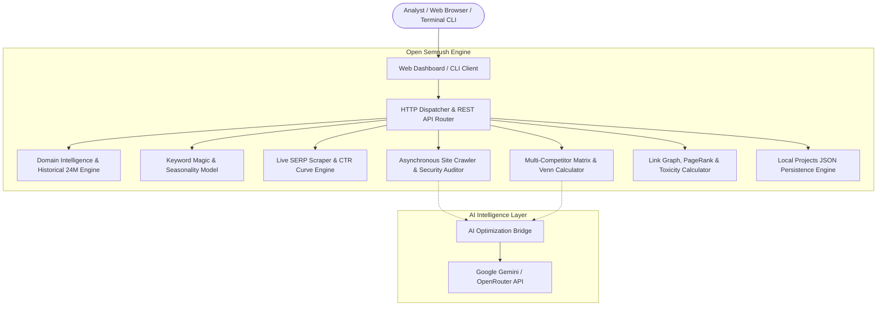

<div align="center">

# 🚀 Open Semrush (Semrush Studio)

### *The High-Performance, Privacy-First, Open-Source Alternative to Semrush & Ahrefs*

[](https://github.com/mightyalok00/open-semrush/releases)
[](https://opensource.org/licenses/MIT)
[](https://nodejs.org/)
[](https://www.docker.com/)
[](https://www.typescriptlang.org/)
[](#-zero-dependency-architecture)

<p align="center">
  <b>A full-featured competitive SEO suite delivering Technical Crawling, Live Google SERP Top 10, Multi-Competitor Gap Matrices, Penguin Toxicity Analytics, and Gemini AI Remediation.</b>
</p>

<p align="center">
  <a href="#-quickstart">Quickstart</a> •
  <a href="#-feature-matrix--comparison">Why Open Semrush</a> •
  <a href="#-deep-dive-suite-capabilities">Capabilities</a> •
  <a href="#-architecture">Architecture</a> •
  <a href="#-docker-deployment">Docker</a> •
  <a href="#-rest-api-documentation">REST API</a> •
  <a href="#-cli-suite">CLI</a>
</p>

---

</div>

## 📊 Feature Matrix & Comparison

Why pay **$1,500 – $6,000 every year** when you can run a private, unmetered SEO intelligence engine directly on your own machine or private cloud?

| Feature / Capability | 🚀 **Open Semrush** | 🟧 **Semrush (Pro/Guru)** | 🟦 **Ahrefs (Lite/Std)** |
| :--- | :---: | :---: | :---: |
| **Pricing** | **100% Free & Open-Source** | $139.95 – $249.95 / mo | $129 – $249 / mo |
| **Monthly Query Quotas** | **Unlimited (Unmetered)** | 500 – 1,500 queries / day | 500 export credits / mo |
| **Data Privacy & Telemetry** | **Self-Hosted / Local Only** | Third-party tracking | Third-party tracking |
| **Technical Site Health Audit** | **Included (TTFB, Security, Schema)** | Included | Included |
| **24-Month Google Core Update Pins** | **Included (Interactive SVG)** | Limited to Guru tier | Not directly correlated |
| **Live Google SERP Top 10 + CTR** | **Included (Curve-based CTR)** | Included | Included |
| **Multi-Competitor Matrix (up to 5)** | **Included (Podium Badges)** | Guru tier required | Standard tier required |
| **Interactive SVG Venn Diagram** | **Included (Clickable Nav)** | Static / Table only | Static / Table only |
| **Backlink Penguin Toxicity Score** | **Included** | Guru tier ($249/mo) | Separate add-on |
| **AI Remediation ("✨ Fix with AI")** | **Gemini & OpenRouter Built-in** | AI App Store ($20+/mo) | None / Manual |
| **AI Outrank Content Strategist** | **H1-H3 Outline + Points** | Content Marketplace ($) | None |
| **Data Export** | **RFC 4180 CSV + Print PDF** | Paywalled per seat | Paywalled export limits |
| **Runtime Footprint** | **< 35MB RAM (Pure Node)** | Heavy SaaS | Heavy SaaS |

---

## 🏗️ Architecture

Open Semrush is built from the ground up without heavy frameworks. The backend uses native Node.js runtime primitives (`node:http`, `node:fs`, `node:url`, native `fetch`), guaranteeing instant cold starts (< 100ms) and minimal RAM utilization.



---

## ⚡ Deep Dive: Suite Capabilities

### 1. 🌐 Domain Overview & Historical Algorithm Trajectory
- **Domain Authority Score (0–100):** Algorithmic composite evaluating referring domain quality, dofollow ratios, and organic reach.
- **Estimated Monthly Traffic & Indexed Keywords:** Computes estimated visits and ranked terms across multiple target geos (`US`, `UK`, `IN`, `DE`, `CA`, `AU`).
- **24-Month Trajectory Area Chart:** Handcrafted vector SVG graph mapping 2-year traffic shifts with **milestone pins for real Google Core Algorithm Updates** (e.g., March 2025, August 2025, March 2026, September 2026).
- **Competitor Discovery:** Automatically pinpoints top rivals with one-click drill-down shortcuts.

### 2. 🔑 Keyword Magic Tool & Seasonality Trends
- **Search Volume & Keyword Difficulty (KD%):** Categorizes competition tiers (`Easy`, `Moderate`, `Very Hard`) with visual gradient gauges.
- **Commercial Intent Modeling:** Classifies user intent into `Commercial`, `Informational`, `Navigational`, or `Transactional`.
- **12-Month Seasonality Bars:** Visualizes seasonal demand peaks from January to December.
- **CPC & Competitive Density:** Evaluates paid advertising benchmarks ($ USD) and bidding competition (0.00 to 1.00).

### 3. 🎯 Live Google SERP Top 10 & SERP Features Inspector
- **Real-Time Top 10 Rankings:** Displays live titles, URLs, and snippet descriptions.
- **Logarithmic CTR Curve:** Projects organic click distribution from Position 1 (39.8%) down to Position 10 (1.6%).
- **SERP Features Detection:** Identifies **Featured Snippets (Position 0)**, **People Also Ask (PAA)** interactive accordions, **Video Packs**, and **Knowledge Panels**.

### 4. 🛠️ Technical Site Audit, Security Headers & Crawler
- **Site Health Score (0–100):** Weighted audit scoring penalizing Errors (–5 pts), Warnings (–2 pts), and Notices (–0.5 pts).
- **On-Page Diagnostics:** Identifies title length infractions, missing meta descriptions, H1 tag irregularities, images missing alt attributes, and word count deficits.
- **Server Infrastructure & Security:** Validates `robots.txt`, XML sitemap discovery, Time to First Byte (TTFB) latency in ms, payload compression (gzip/br), `HSTS` (Strict-Transport-Security), `CSP` (Content-Security-Policy), and `Schema.org` JSON-LD Structured Data.
- **✨ Fix with AI:** Streams optimized, copy-paste HTML replacements directly into a modal drawer via Gemini.

### 5. ⚔️ Multi-Competitor Keyword Gap & SVG Venn Diagram
- **Multi-Domain Matrix (Up to 5 Domains):** Side-by-side keyword overlap table highlighting the ranking leader for each query with gold podium badges.
- **Tri-Category Segmentation:**
  - **Missing (Opportunity):** Keywords your competitors rank for, but your site does not.
  - **Shared:** Common battleground keywords where both domains compete.
  - **Unique:** Your proprietary competitive moat.
- **Interactive SVG Venn Diagram:** 2-circle vector illustration allowing you to click circle segments or intersection zones to smoothly scroll directly to target keyword lists.
- **⚡ Outrank Plan:** Produces an AI-crafted content blueprint with recommended title, word count, and H1/H2/H3 outline.

### 6. 🔗 Backlink Analytics & Penguin Toxicity Engine
- **Inbound Link Graph:** Total backlink count, referring root domains, and dofollow vs. nofollow ratio bars.
- **Penguin Toxicity Risk Score:** Algorithmic calculation evaluating suspicious TLDs, non-descriptive anchors, and linking velocity to assign `Low Risk`, `Moderate`, or `High Risk` warning levels.
- **Semrush Anchor Category Distribution:** Automatically classifies backlink anchor text into **Branded**, **Exact Match**, **Naked URL**, and **Generic** buckets.
- **Live Inbound Feed:** Real-time stream of incoming links with target destinations and source PageRank authority.

### 7. 📄 Data Portability & Executive Reporting
- **RFC 4180 CSV Export:** Exports all keyword tables and metrics with double-quote escaping for spreadsheet software (Excel, Google Sheets).
- **Executive PDF Print Stylesheet:** High-resolution unpaginated `@media print` styling for client deliverables and executive reports.

---

## 🚀 Quickstart

### Prerequisites
- [Node.js](https://nodejs.org/) v18.0.0 or higher
- (Optional) [Docker](https://www.docker.com/) & Docker Compose

### 📦 Local Installation (Under 60 Seconds)

```bash
# 1. Clone the repository
git clone https://github.com/mightyalok00/open-semrush.git
cd open-semrush

# 2. Configure environment (optional, required only for AI features)
cp .env.example .env

# 3. Start the Web Studio & API server
npm start
```

🎉 Open your browser at **`http://localhost:3000`** to access the dashboard.

---

## 🐳 Docker Deployment

Run Open Semrush as an isolated container in your homelab or production VPS:

```bash
# Build and launch in detached mode
docker compose up -d

# Verify container health
docker compose ps
```

To stop the container:
```bash
docker compose down
```

---

## 💻 CLI Suite

Open Semrush includes a terminal CLI utility for automation, pipelines, and developer workflows:

```bash
# Technical Site Audit (crawls 5 pages)
node scripts/semrush.mjs audit https://example.com --pages 5

# Keyword Difficulty & Intent Analysis
node scripts/semrush.mjs keyword "best seo tools"

# Domain Overview & Traffic Estimation
node scripts/semrush.mjs domain github.com

# Pairwise Competitor Keyword Gap
node scripts/semrush.mjs gap github.com gitlab.com

# Backlink Profile & Anchor Distribution
node scripts/semrush.mjs backlinks github.com
```

---

## 📡 REST API Documentation

Open Semrush exposes clean JSON endpoints for integration into third-party dashboards and automated pipelines:

| Method | Endpoint | Query / Body Parameters | Response Summary |
| :--- | :--- | :--- | :--- |
| `GET` | `/api/domain` | `?domain=github.com&country=us` | Authority Score, monthly traffic, top keywords, 24-month history |
| `GET` | `/api/keyword` | `?q=seo+tools` | Search volume, KD%, intent, CPC, 12-month seasonality |
| `GET` | `/api/serp` | `?q=best+seo+software` | Top 10 rankings, snippet, CTR, PAA questions, featured snippet |
| `POST` | `/api/audit` | `{"url": "https://example.com", "maxPages": 5}` | Health score, on-page issues, TTFB latency, security headers |
| `GET` | `/api/gap` | `?domainA=site1.com&domainB=site2.com` | Pairwise missing, shared, and unique keyword arrays |
| `GET` | `/api/gap/multi` | `?domains=site1.com,site2.com,site3.com` | Multi-competitor matrix with leader highlights |
| `GET` | `/api/backlinks` | `?domain=github.com` | Link count, referring domains, toxicity score, anchor distribution |
| `POST` | `/api/ai/fix` | `{"url": "...", "issueCode": "...", "message": "..."}` | Gemini copy-paste code snippet and SEO rationale |
| `POST` | `/api/ai/strategy` | `{"domainA": "...", "competitorDomain": "...", "missingKeyword": "..."}` | Outrank article blueprint, title, and H1/H2/H3 outline |
| `GET` | `/api/projects` | *None* | List of previously audited domains and health scores |

#### Example: Analyzing a Domain via cURL
```bash
curl -s "http://localhost:3000/api/domain?domain=github.com&country=us" | jq .
```

---

## ⚙️ Environment Variables

Create a `.env` file in the project root to enable AI-powered fixes and content strategies:

| Variable | Required | Description | Example |
| :--- | :---: | :--- | :--- |
| `PORT` | Optional | Web server listening port (Default: `3000`) | `3000` |
| `NODE_ENV` | Optional | Environment mode | `production` |
| `GEMINI_API_KEY` | Optional | Google Gemini API Key for AI features | `AIzaSy...` |
| `OPENROUTER_API_KEY`| Optional | OpenRouter API Key (alternative provider) | `sk-or-v1-...` |

*Get a free Gemini API key from [Google AI Studio](https://aistudio.google.com/).*

---

## 🔒 Zero-Dependency Architecture

Unlike many modern web projects burdened with hundreds of transitive NPM dependencies, Open Semrush's core engines (`crawler.ts`, `domain.ts`, `keywords.ts`, `serp.ts`, `backlinks.ts`) are implemented using **standard Node.js built-ins**:
- `node:http` — Fast, native asynchronous HTTP/REST server
- `node:fs` — Local database file persistence
- `node:url` — Robust URL parsing and normalization
- Native `fetch` — Streaming HTML crawler and outbound probes

This guarantees:
- 🛡️ **Zero Supply-Chain Vulnerabilities:** Immune to malicious dependency injections.
- ⚡ **Instant Startup:** Server starts in **< 100 milliseconds**.
- 🪶 **Tiny Footprint:** Production container weighs less than **80 MB**.

---

## 🗺️ Roadmap

- [x] Technical Site Crawler with TTFB, HSTS, CSP, and Schema.org
- [x] Live Google SERP Top 10 with logarithmic CTR curve & PAA questions
- [x] 24-Month Traffic Trajectory Area Chart with Google Core Update pins
- [x] Multi-Competitor Gap Matrix (Up to 5 Domains) & Interactive SVG Venn Diagram
- [x] Backlink Analytics with Penguin Toxicity Scoring & Semrush Anchor Taxonomy
- [x] AI-Powered Code Remediation & Outrank Content Strategy Builder
- [x] RFC 4180 CSV Export & Executive Print PDF Stylesheet
- [ ] Automated Scheduled Crawls with Webhook Alerts (Slack / Discord)
- [ ] Google Search Console (GSC) OAuth2 Integration
- [ ] Core Web Vitals (LCP, FID, CLS) Real-User Metric Gauges

---

## 🤝 Contributing

Contributions make the open-source community thrive!
1. **Fork the Project**
2. **Create your Feature Branch** (`git checkout -b feat/amazing-feature`)
3. **Commit your Changes** (`git commit -m 'feat: add amazing feature'`)
4. **Push to the Branch** (`git push origin feat/amazing-feature`)
5. **Open a Pull Request**

---

## 📜 License

Distributed under the **MIT License**. See [`LICENSE`](LICENSE) for more information.

<div align="center">
  <sub>Built with ❤️ by <a href="https://github.com/mightyalok00">mightyalok00</a> and the open-source community.</sub>
</div>
