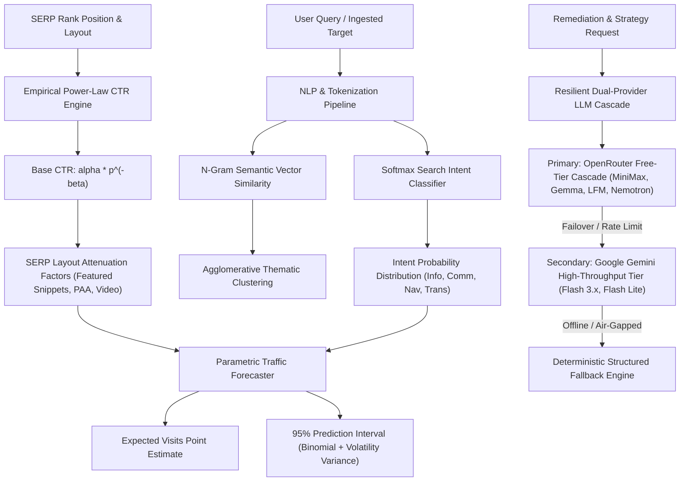

# AI & Machine Learning Architecture Specification

This document details the applied machine learning, statistical non-linear regression, probabilistic NLP classification, and multi-model LLM cascade architectures implemented in `open-semrush`.

---

## 1. Executive Architecture Map



---

## 2. Empirical Click-Through-Rate (CTR) Power-Law Regression

### Mathematical Formulation

Organic click distributions follow an empirical power-law decay with rank depth:

$$\text{CTR}_{\text{base}}(p) = \alpha \cdot p^{-\beta}$$

Where:

- $p \in \mathbb{N}_{\ge 1}$ is the 1-indexed organic SERP rank.
- $\alpha = 0.312$ corresponds to the empirical baseline click-through rate for Position 1 (~31.2%).
- $\beta = 0.93$ represents the power decay parameter across search depth.

### SERP Layout Feature Attenuation Multipliers

Modern search engine result pages contain rich visual elements that cannibalize organic clicks. The final adjusted click-through rate is modeled as:

$$\text{CTR}_{\text{adj}}(p) = \text{CTR}_{\text{base}}(p) \cdot \prod_{k} \mu_k$$

| Layout Feature | Affected Ranks | Multiplier ($\mu_k$) | Empirical Phenomenon |
| --- | --- | --- | --- |
| **Featured Snippet** | Rank 1 | $0.72$ (-28%) | Direct query answer absorbs click intent from Position 1 |
| **Featured Snippet** | Rank 2 | $0.88$ (-12%) | Visual distraction and secondary content suppression |
| **Video Carousel** | Ranks $\ge 3$ | $0.85$ (-15%) | Media thumbnails intercept attention before textual snippets |
| **Knowledge Panel** | Ranks $\ge 2$ | $0.90$ (-10%) | Right-rail entity card satisfies brand exploration |
| **People Also Ask (PAA)** | Ranks 3–6 | $0.92$ (-8%) | Accordion expansion diverts users into related sub-queries |

---

## 3. Probabilistic Multi-Class Search Intent Classifier

### Softmax Probability Distribution

Rather than assigning rigid binary labels, `open-semrush` evaluates multi-dimensional logit features across four canonical search intents:

$$\mathbf{z} = (z_{\text{Info}}, z_{\text{Comm}}, z_{\text{Nav}}, z_{\text{Trans}}) \in \mathbb{R}^4$$

The logit components combine lexical pattern detectors, syntactic interrogative markers, domain TLD anchors, and query token length priors:

$$P(\text{Intent} = i \mid Q) = \frac{\exp(z_i - \max(\mathbf{z}))}{\sum_{j} \exp(z_j - \max(\mathbf{z}))}$$

The subtraction of $\max(\mathbf{z})$ guarantees numerical stability, preventing arithmetic floating-point overflow during exponentiation.

### Intent Classes & Priors

1. **Informational**: General problem solving, questions (`how`, `what`, `why`), and multi-token educational queries.
2. **Commercial**: Comparative evaluation (`best`, `vs`, `review`, `alternatives`, `specs`).
3. **Navigational**: Direct destination queries, brand portals, domain extensions (`.io`, `.com`), and account gateways (`login`, `portal`).
4. **Transactional**: Immediate purchase intent (`buy`, `pricing`, `discount`, `order`, `hire`).

---

## 4. Parametric Traffic Forecasting & 95% Confidence Bounds

### Point Estimate

Given search volume $V$ and adjusted click rate $\text{CTR}_{\text{adj}}$:

$$\hat{Y} = \text{round}(V \cdot \text{CTR}_{\text{adj}})$$

### Uncertainty Variance Decomposition

Traffic prediction uncertainty combines binomial sampling dispersion with seasonal volatility variance:

$$\sigma_{\text{total}}^2 = \sigma_{\text{binomial}}^2 + \sigma_{\text{volatility}}^2$$

$$\sigma_{\text{binomial}}^2 = V \cdot \text{CTR}_{\text{adj}} \cdot (1 - \text{CTR}_{\text{adj}})$$

$$\sigma_{\text{volatility}}^2 = (\hat{Y} \cdot \nu)^2$$

Where $\nu = 0.12$ represents the empirical baseline volatility factor.

### 95% Prediction Interval

Using the two-tailed standard normal critical value $z_{0.025} = 1.96$:

$$\text{Margin of Error} = 1.96 \cdot \sigma_{\text{total}}$$

$$I_{0.95} = \hat{Y} \pm 1.96 \sigma_{\text{total}}$$

---

## 5. N-Gram Semantic Vector Similarity & Keyword Clustering

### Character 3-Gram Jaccard Metric

For query representations $Q_A$ and $Q_B$, character trigrams are extracted across boundary-padded tokens:

$$\text{Sim}(Q_A, Q_B) = \frac{|\mathcal{G}_3(Q_A) \cap \mathcal{G}_3(Q_B)|}{|\mathcal{G}_3(Q_A) \cup \mathcal{G}_3(Q_B)|}$$

This metric provides:

- Word order invariance for composite search terms.
- Typographical noise and inflection tolerance without heavy lemmatizer overhead.
- Symmetric and normalized bounded output in the interval $0.0 \le \text{Sim} \le 1.0$.

### Agglomerative Thematic Clustering

The clustering engine aggregates related keyword opportunities into topical clusters using a greedy distance threshold $\tau = 0.35$. Each cluster emits:

- Thematic anchor query.
- Aggregated search volume.
- Average keyword difficulty index.

---

## 6. Multi-Provider LLM Fallback Cascade

`open-semrush` incorporates an autonomous multi-tier inference cascade designed for high availability and zero operational downtime:

```text
[Incoming AI Task]
        │
        ▼
[Tier 1: OpenRouter Free Model Pool]
  ├─ minimax/minimax-m3.1-flash:free
  ├─ google/gemma-4-31b-it:free
  ├─ google/gemma-4-26b-a4b-it:free
  ├─ liquid/lfm-2.5-2.6b:free
  ├─ nvidia/nemotron-3.5-lightning:free
  └─ openrouter/free
        │ (On 429, 503, or invalid key)
        ▼
[Tier 2: Google Gemini Dedicated API Pool]
  ├─ gemini-3.5-flash
  ├─ gemini-3.5-flash-lite
  ├─ gemini-3.1-flash-lite
  ├─ gemini-3.8-flash
  ├─ gemini-3.7-flash
  └─ gemini-flash-lite-latest
        │ (Offline / air-gapped / no key)
        ▼
[Tier 3: Deterministic Rule Engine Fallback]
  └─ Heuristic code fix templates & structured SEO blueprints
```

### Safety & Resiliency Controls

- **Circuit Breaking**: HTTP 401/403 credential rejections permanently invalidate the failed key in-memory for the process lifetime, preventing log spam and wasted round-trips.
- **Strict 15-Second Timeout**: Every outgoing inference request enforces an `AbortController` timeout.
- **Fail-Closed Privacy**: No crawler payload containing authenticated secrets, bearer headers, or internal IP space is ever forwarded to external inference providers.
- **Structured JSON Repair**: Responses with markdown fences (`json`) or extraneous commentary are parsed through regex bracket extraction.
