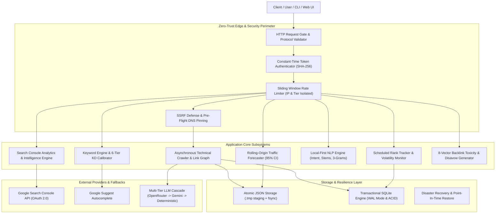
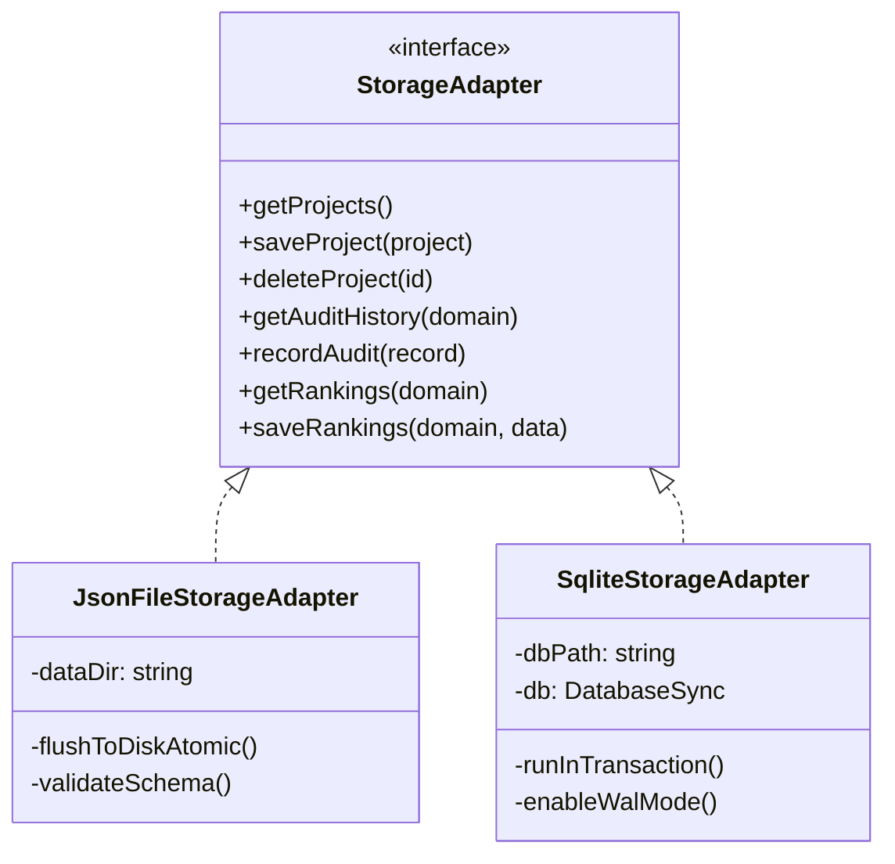
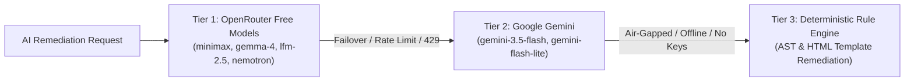

# Open Semrush System Architecture & Engineering Specification

This document details the software architecture, security mechanisms, persistence models, and inference pipelines of `open-semrush`.

---

## 1. System Architecture Map



---

## 2. Zero-Trust Security & SSRF Defense

Open Semrush executes outbound network requests to crawl user-requested targets. To eliminate Server-Side Request Forgery (SSRF), Cloud Metadata theft, and DNS Rebinding Time-of-Check to Time-of-Use (TOCTOU) exploits, all outbound HTTP operations strictly enforce the following security pipeline:

### A. Pre-Flight DNS Resolution & Scope Validation
Before any socket connection is initiated, the target hostname is resolved via `dns.lookup`. The resolved IP address is validated against non-public scopes:
- **IPv4 Denied Blocks**:
  - `0.0.0.0/8` (Current network)
  - `10.0.0.0/8` (Private RFC 1918)
  - `100.64.0.0/10` (Carrier-grade NAT)
  - `127.0.0.0/8` (Loopback addresses)
  - `169.254.0.0/16` (Link-local & AWS/GCP/Azure Cloud Metadata `169.254.169.254`)
  - `172.16.0.0/12` (Private RFC 1918)
  - `192.0.0.0/24` (IETF protocol assignments)
  - `192.0.2.0/24`, `198.51.100.0/24`, `203.0.113.0/24` (Documentation test nets)
  - `192.168.0.0/16` (Private RFC 1918)
  - `198.18.0.0/15` (Benchmarking network)
  - `224.0.0.0/4` (Multicast)
  - `240.0.0.0/4` (Reserved for future use)
  - `255.255.255.255/32` (Broadcast)
- **IPv6 Denied Scopes**:
  - `::1/128` (Loopback)
  - `::/128` (Unspecified)
  - `::ffff:0:0/96` (IPv4-mapped addresses re-checked against IPv4 blacklist)
  - `fe80::/10` (Link-local unicast)
  - `fc00::/7` (Unique local addresses / ULA)
  - `ff00::/8` (Multicast)
  - `2001:db8::/32` (Documentation)

### B. Socket DNS Pinning (TOCTOU Immunity)
Traditional HTTP clients re-resolve hostnames when creating TCP sockets, introducing a race condition where a malicious DNS server returns a public IP during pre-flight validation and `127.0.0.1` or `169.254.169.254` during socket creation.
Open Semrush defeats this by **pinning the verified IP address**:
```typescript
// Custom agent lookup intercepts connection and returns the pre-verified IP
const options: http.RequestOptions = {
  lookup: (_hostname, _options, callback) => {
    callback(null, pinnedIp, pinnedFamily);
  },
  headers: {
    Host: targetHostname, // Preserves SNI and virtual host routing
  }
};
```

### C. In-Flight Redirect Re-Validation
Attackers often redirect from an allowed public URL to an internal network URL (e.g., `302 Found -> http://169.254.169.254/latest/meta-data`).
Open Semrush intercepts every redirect hop:
1. Re-verifies target protocol (`http:` or `https:` only).
2. Performs full pre-flight DNS validation on the redirect target.
3. Pins the newly resolved IP for the next socket.
4. Hard caps redirection depth at 5 hops to prevent cycle exhaustion attacks.

---

## 3. Dual-Engine Storage Architecture

Open Semrush supports dual storage adapters through a unified abstract interface:



### A. Atomic JSON Storage Engine (`JsonFileStorageAdapter`)
- **Staging & Atomic Replacement**: Changes are written to a temporary sibling file (`data/seo_projects.json.tmp.<pid>`), flushed to physical media via `fs.fsyncSync`, and atomically renamed (`fs.renameSync`). This guarantees zero file corruption during power loss or hard process termination.
- **Fail-Closed Corruption Defense**: On startup and read, persisted records are validated against strict runtime schemas. Corrupt files are never silently overwritten; they are preserved for manual recovery and rejected.
- **File Permissions**: Files are created with restrictive `0o600` permissions (owner read/write only).

### B. Transactional SQLite Engine (`SqliteStorageAdapter`)
- **High-Performance Relational Backend**: Implemented via Node's native `node:sqlite` (`DatabaseSync`), requiring zero external native binary dependencies.
- **Write-Ahead Logging (WAL)**: Configures `PRAGMA journal_mode = WAL; PRAGMA synchronous = NORMAL;`, allowing concurrent non-blocking readers alongside active transaction writers.
- **ACID Transaction Rollback**: All mutations execute within immediate transactions. Any constraint violation triggers automatic rollback with zero partial state persistence.
- **High-Concurrency Contention Verified**: Tested across 20 parallel asynchronous workers with zero lock starvation or data corruption.

---

## 4. Multi-Tier AI Remediation Cascade

For autonomous SEO code remediation and strategy generation, Open Semrush implements a 3-tier resilient cascade:



1. **Tier 1 (OpenRouter Free Tier)**: Dispatches requests across high-capability free models with in-flight retry on secondary models upon token exhaustion or provider latency.
2. **Tier 2 (Google Gemini Flash)**: High-speed, high-context fallback utilizing official Gemini REST endpoints with structured JSON schemas.
3. **Tier 3 (Deterministic Rule Engine)**: Ensures that even in an air-gapped environment without external internet access or API keys, OpenSemrush returns deterministic, syntax-valid HTML/schema fixes for all standard SEO issues (`MISSING_TITLE`, `MISSING_CANONICAL`, `OPENGRAPH_ABSENT`, `ROBOTS_NOINDEX`).

---

## 5. Production Observability & Hardening

- **Constant-Time Authentication**: Uses `crypto.timingSafeEqual` over SHA-256 digests to prevent timing side-channel attacks during token verification.
- **Zero-Downtime Secret Rotation**: Accepts comma-separated bearer tokens in `OPEN_SEMRUSH_API_TOKENS`. The primary token can be rotated without service restart.
- **Graceful Draining Shutdown**: On `SIGTERM` / `SIGINT`, the server immediately stops accepting new connections, returns `503 Service Unavailable (draining)` to in-flight arrivals, and allows up to 10 seconds for active crawls and database writes to flush cleanly before exiting.
- **Streaming Body Constraints**: Incoming request payloads are capped at 1 MiB to prevent memory exhaustion DoS attacks.
- **Reverse Proxy Header Sanitization**: `cleanIpCandidate` validates header values against port injection and IPv6 zone index exploits before parsing client IP addresses.
